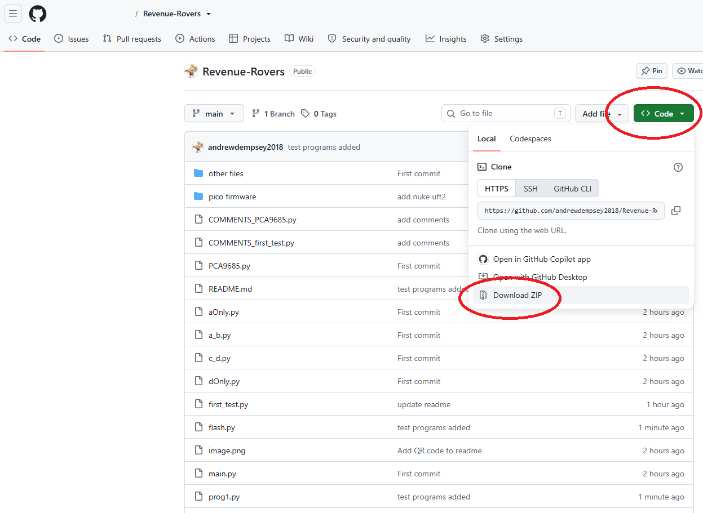
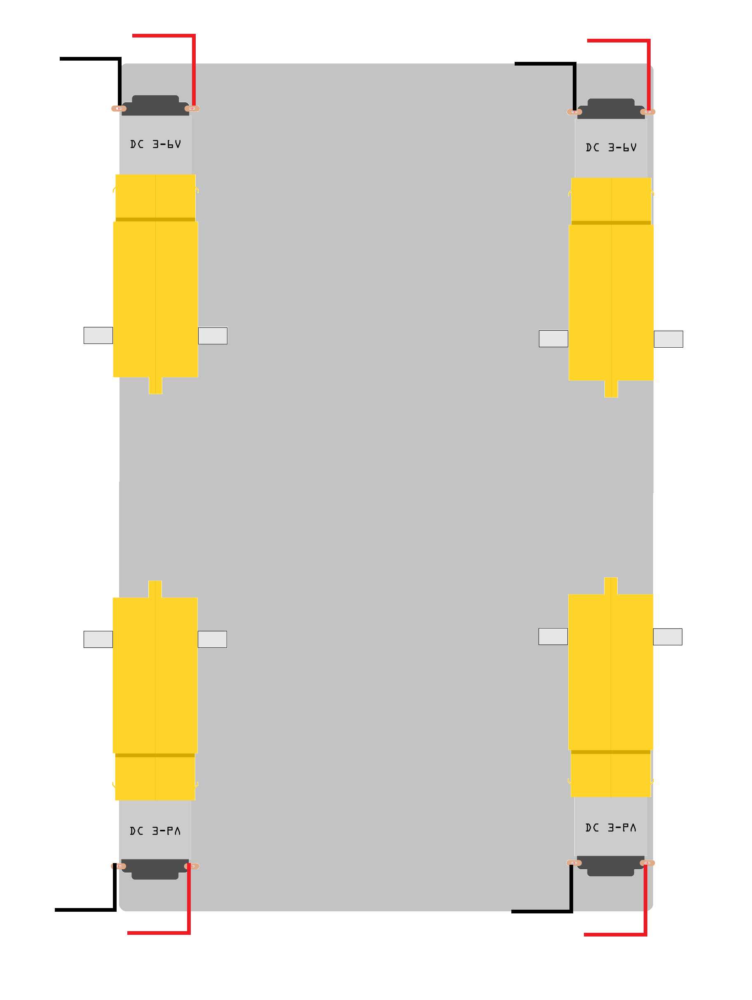

# Revenue Rovers

Demonstration of electronics and software development for students

# Link to Repo

Scan this QR code to access the code!

# Pico microcontroller boards
Raspberry Pi Pico is a development board that uses Raspberry Pi microcontrollers (RP2040 or RP2350). A Raspberry Pi Pico is programmed using MicroPython, C, or C++ and, unlike other Raspberry Pi devices, doesn’t run Linux or support removable storage. Instead, Raspberry Pi Pico is programmed by flashing binaries to the on-board flash memory.

# Raspberry Pi Pico Setup
To update the firmware on a Raspberry Pi Pico (such as MicroPython or CircuitPython), use the official MicroPython Download Page to grab the .uf2 file for your specific model (Pico, Pico W, Pico 2, or Pico 2 W) and drag-and-drop it onto the device.

1. Download the Firmware: Go to the MicroPython Download Page or your preferred firmware provider (like CircuitPython) to download the .uf2 file matching your board.
2. Enter Bootloader Mode: Press and hold the BOOTSEL button on your Raspberry Pi Pico while plugging the USB cable into your computer.
3. Release BOOTSEL: Once plugged in, release the button. The Pico will mount as a mass storage drive named RPI-RP2 (or RP2350 for Pico 2).
4. Copy the File: Drag and drop the downloaded .uf2 file directly into the RPI-RP2 drive.
5. Auto-Reboot: The Pico will automatically flash the new firmware and restart.

# Steps to Wipe the Pico
1. Download the nuke file: Get the flash_nuke.uf2 file from Raspberry Pi.
2. Enter Bootloader Mode: Disconnect the Pico from your computer. Press and hold the BOOTSEL button on the board, and while holding it down, plug the USB cable into your computer.
3. Open the Drive: Release the BOOTSEL button once it is plugged in. The Pico will appear on your computer as a mass storage device drive named RPI-RP2.
4. Copy the File: Drag and drop the flash_nuke.uf2 file directly into the RPI-RP2 drive.
5. Wait for Completion: The Pico will run the nuke script, clear its entire flash memory, and automatically reboot. After about 10 seconds, it will remount as a blank mass storage device.
Once wiped, you can drag and drop a fresh firmware file (such as MicroPython or CircuitPython) onto the drive to start clean.

# Thonny
Thonny is a free, lightweight Python Integrated Development Environment (IDE) built specifically for students. Developed at the University of Tartu in Estonia, it strips away the overwhelming clutter of professional editors and bundles its own copy of Python so you can start coding immediately.

It connects directly over USB to microcontrollers like the Raspberry Pi Pico or ESP32, making it a go-to tool for basic electronics and robotics.

Get it here:

https://thonny.org/

# Pulse-Width Modulation

Pulse-Width Modulation (PWM) is a clever trick that lets a computer control power by switching electricity on and off super fast. Because digital computers only speak in "on" (1) and "off" (0), PWM mimics medium power levels by changing how long the power stays on during each tiny fraction of a second.

How It Works

• The Light Switch Analogy: Imagine flipping a bedroom light switch on and off hundreds of times per second. Your eyes cannot see the individual flashes, so the room just looks dimmer.
• Duty Cycle: This is the percentage of time the power stays "on" during one quick cycle. A 50% duty cycle means the power is on half the time and off half the time, giving the device half power.
• Pulse Width: This refers to the actual length of each "on" pulse. Wider pulses send more energy, while skinnier pulses send less.

Why Robots Use PWM

• Motor Speed: Sending a 100% duty cycle makes a rover's wheels spin at full speed, while a 25% duty cycle makes them crawl slowly.
• Servo Steering: Standard servo motors read the exact width of a pulse to know what angle to turn to, such as pointing wheels straight ahead or turning left.
• LED Brightness: Robots use PWM to smoothly fade indicator lights up and down instead of just snapping them on and off.

# GitHub

Git and version control act like a "time machine" and a team notebook for your code. It tracks every change you make to your robot's programs so you can undo mistakes, experiment safely, and work together with classmates without overwriting each other's files.

How It Works

• The Video Game Save Point Analogy: Imagine playing a tough level in a video game. Whenever you write a piece of robot code that works well, you create a commit (a save point) so you can always jump back to it if a new experiment breaks your rover.
• The Repository (Repo): This is the master project folder stored online (like on GitHub) that holds all your robot's files and the full history of every save point ever made.
• Branches: If you want to test a crazy new driving trick without ruining the main working code, you create a separate branch. Once your test works, you merge it back into the main project.

# Session outline

1. Build the Revenue Rovers

• Chassis Assembly: Put together the physical frame, wheels, and motors of the rover.
• Wiring and Power: Connect the microcontroller to the PCA9685 PWM driver board via GPIO pins. Wire the motors to the driver board and attach the battery to power the motors.

2. Flash Firmware and Add Libraries

• Install Python: Flash the microcontroller (Raspberry Pi Pico) so it can execute Python scripts directly.
• Upload Drivers: Copy the PCA9685.py library file onto the board's flash storage. This driver allows the microcontroller to communicate with the external PWM board to control motor speed.

3. Calibrate Motors (prog1.py)

• Find Neutral Points: Run prog1.py to determine the exact pulse-width modulation (PWM) values where the motors stop completely or where steering servos sit dead center.
• Set Speed Limits: Record minimum duty cycles needed to overcome wheel friction and maximum safe speeds so future scripts drive accurately.

4. Test Basic Movement (prog2.py)

• Verify Drivetrain: Execute prog2.py to run a baseline sequence of driving forward, reversing, and turning left or right.
• Troubleshoot Polarity: Confirm that the wheels spin in the expected directions. If a wheel spins backward during a forward command, swap its motor wires or invert its direction in the code.

5. Develop and Commit Custom Code

• Write New Behaviors: Build custom scripts using your calibrated motor values to add features like obstacle avoidance, line following, or remote control.
• Version Control: Push your working scripts to the shared Git repository so teammates can track changes, review code, and back up functional rover builds.

# How to download your code

# Step 1
